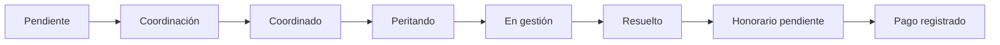
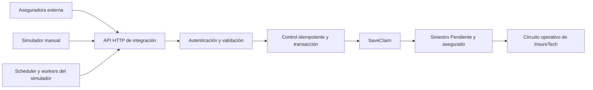

<div align="center">


# InsureTech Assess

**Gestión de siniestros, coordinación de pericias y seguimiento de honorarios.**

Un mismo espacio para compañías, asegurados, productores, talleres y peritos.


[Estado actual](#-estado-actual) · [Funcionalidades](#-funcionalidades) · [Instalación](#-instalación) · [Simulación](#-integración-de-aseguradoras-y-laboratorio) · [Pruebas](#-pruebas) · [Próximos pasos](#-próximos-pasos)

</div>

---

## 📌 Estado actual

**Proyecto en desarrollo funcional**, con circuito operativo de siniestros, acceso por roles y un laboratorio autónomo para probar el ingreso de casos desde aseguradoras ficticias.

Actualmente se puede recibir un siniestro por HTTP, incorporarlo al módulo operativo, coordinar la inspección, asignar un perito, gestionar la pericia y registrar su cierre y honorarios. El laboratorio permite alimentar ese circuito manualmente o mediante ejecuciones automáticas de múltiples compañías.

| Disponible | Próxima etapa |
| :--- | :--- |
| API de recepción con autenticación por compañía, validación estricta e idempotencia. | Integraciones con sistemas reales de aseguradoras y preparación operativa del despliegue productivo. |
| Simulador manual y autónomo, persistencia, escenarios, reintentos y métricas. | Ampliar escenarios y cobertura de recorridos completos de la interfaz. |
| Pruebas PHPUnit, integración HTTP real y concurrencia MySQL en entornos aislados. | **Laravel Dusk** para pruebas automatizadas en navegador real. |

> El laboratorio utiliza la API real de la aplicación. Esto permite validar el canal de entrada previsto para producción; no significa que ya existan aseguradoras externas conectadas ni un despliegue productivo validado.

## ✨ Funcionalidades

| Módulo | Qué permite hacer |
| :--- | :--- |
| **Integración de aseguradoras** | Recibir siniestros por HTTP con credenciales por compañía, validación, trazabilidad e idempotencia. |
| **Laboratorio de simulación** | Generar lotes manuales o ejecuciones autónomas multiaseguradora, con escenarios, límites, historial, métricas y control de procesos desde el panel. |
| **Dashboard** | Consultar cantidades por estado, filtrar siniestros y comparar compañías con un gráfico de barras. |
| **Siniestros** | Gestionar estados, adjuntos, datos del asegurado y asignaciones; consultar listados con búsqueda y paginación. |
| **Coordinación** | Registrar modalidad, fecha, horario y domicilio; buscar y confirmar el punto de una pericia presencial. |
| **Hojas de ruta** | Asignar o reasignar peritos y revisar sus inspecciones por día en un mapa con enlaces al siniestro. |
| **Gestión del perito** | Registrar observaciones, adjuntos, unidades de chapa, mecánica y pintura, y repuestos con Select2. |
| **Talleres** | Administrar talleres homologados y no homologados, con domicilio, contacto y horarios; alta desde un modal con control de duplicados. |
| **Configuración** | Definir valores de reparación y honorarios de inspección, para una compañía o para todas las compañías actuales. |
| **Honorarios** | Confirmar cierres, consultar cantidades e importes por perito y compañía y registrar pagos. |
| **Administración** | Gestionar usuarios, roles y noticias. |

### Circuito principal



> Las pericias presenciales requieren una ubicación confirmada al pasar a **Coordinado**. Las inspecciones por fotos o videollamada quedan fuera del mapa.

## 🧰 Tecnologías

- **Backend:** Laravel 12, PHP 8.2 o superior y Eloquent.
- **Interfaz:** Blade, Bootstrap 5, Sass, Vite, jQuery, DataTables y Select2.
- **Datos:** MySQL en desarrollo; SQLite en memoria para pruebas.
- **Permisos:** Spatie Laravel Permission.
- **Mapas:** Leaflet 1.9.4 y OpenStreetMap, con búsquedas puntuales mediante Nominatim.
- **Pruebas:** PHPUnit 11, factories y seeders.

## 🚀 Instalación

### Requisitos

- PHP 8.2 o superior y las extensiones requeridas por Composer y el controlador de base de datos.
- Composer 2.
- Node.js 20.19+ o 22.12+ compatible con Vite 7, y npm.
- Una base de datos MySQL creada para el proyecto.

### Preparar el entorno

Desde la raíz del repositorio:

```bash
composer install
npm ci
cp .env.example .env
php artisan key:generate
php artisan package:discover
```

Editar `.env` con el nombre de la aplicación, su URL y los datos de conexión:

```dotenv
APP_NAME="InsureTech Assess"
APP_ENV=local
APP_URL=http://localhost:8000

DB_CONNECTION=mysql
DB_HOST=127.0.0.1
DB_PORT=3306
DB_DATABASE=insuretech
DB_USERNAME=tu_usuario
DB_PASSWORD=tu_contrasena
```

Crear las tablas:

```bash
php artisan migrate
```

### Datos de demostración

En una **base nueva de desarrollo**, cargar roles, cuentas de prueba y datos de ejemplo:

```bash
php artisan db:seed
```

La carga incluye cinco compañías de seguros y completa los siguientes conjuntos de datos:

| Registros | Cantidad objetivo |
| :--- | ---: |
| Siniestros | 200 |
| Clientes | 200 |
| Talleres | 40 |
| Productores | 8 |
| Inspectores vinculados a usuarios | 10 |

Los siniestros usan números con el prefijo de su compañía, por ejemplo `ML54897894656166` para Mercantil Andina.

> `DatabaseSeeder` inserta roles y permisos con identificadores definidos: no debe repetirse sobre una base ya inicializada. Para completar datos de demostración en un entorno existente, revisar y ejecutar el seeder específico, por ejemplo `php artisan db:seed --class=ClaimSeeder`.

<details>
<summary><strong>Accesos de demostración</strong></summary>

Las cuentas creadas por `SeederUsuariosPorRol` incluyen:

| Rol | Email |
| :--- | :--- |
| CEO | `ceo@example.com` |
| Coordinaciones | `coordinaciones@example.com` |
| Hojas de ruta | `hojas-de-ruta@example.com` |
| Inspectores | `inspectores@example.com` |

Contraseña inicial de estas cuentas: `InsureTech2026!`.

El seeder conserva las contraseñas de las cuentas existentes. También crea cuentas para los demás roles definidos en ese archivo. El rol **Administrativo** se crea sin asignarlo automáticamente a un usuario.

Estas cuentas son exclusivamente para desarrollo y demostración.

</details>

### Iniciar la aplicación

Ejecutar en dos terminales:

```bash
# Terminal 1: aplicación
php artisan serve
```

```bash
# Terminal 2: recursos frontend con recarga
npm run dev
```

Para compilar los recursos:

```bash
npm run build
```

## 👥 Roles y accesos

| Rol | Acceso principal |
| :--- | :--- |
| **CEO** | Administración general, todos los siniestros, configuración de tarifas y honorarios. |
| **Coordinaciones** | Edición y coordinación del siniestro, incluida la búsqueda de su ubicación antes de asignarlo. |
| **Hojas de ruta** | Peritando y Coordinados; asignación de peritos, fechas y horarios, con agenda y mapa. |
| **Inspectores** | Sus propias inspecciones en Peritando o En gestión, su hoja de ruta y sus honorarios. |
| **Administrativo** | Consulta de honorarios, confirmación de cierres y registro de pagos. No configura tarifas. |

Los demás accesos dependen de los roles y permisos asignados. En `APP_ENV=local`, el listado de usuarios permite **iniciar sesión como otro usuario** para probar los distintos perfiles.

## 📍 Ubicaciones y hojas de ruta

La ubicación se registra durante la coordinación:

1. Completar **Dirección** y **Localidad** y seleccionar la modalidad presencial.
2. Usar **Buscar domicilio en el mapa**.
3. Elegir un resultado y revisar el punto; también se puede marcar manualmente sobre el mapa.
4. Presionar **Confirmar punto** y aplicar los cambios del siniestro.
5. Asignar el perito y la fecha desde Hojas de ruta.

El domicilio de la visita y las coordenadas se guardan en `claims`, mediante `inspection_address`, `inspection_latitude` e `inspection_longitude`. El mapa del perito reutiliza esos datos al consultar sus asignaciones del día.

Si cambia el domicilio o la localidad, se debe confirmar nuevamente el punto. Un cambio a modalidad remota elimina las coordenadas de la visita.

### Configuración del mapa

```dotenv
INSPECTION_GEOCODING_URL=https://nominatim.openstreetmap.org/search
INSPECTION_GEOCODING_COUNTRY=ar
INSPECTION_MAP_TILE_URL=https://tile.openstreetmap.org/{z}/{x}/{y}.png
```

Las búsquedas se ejecutan a pedido del usuario, con caché y un límite global de consultas. Los resultados pueden ser aproximados: encontrar una calle no garantiza identificar la altura exacta.

> **Nominatim público:** uso puntual, máximo una consulta por segundo, sin autocompletado ni geocodificación masiva habitual. No enviar nombres ni información personal o confidencial. Consultar su [política de uso](https://operations.osmfoundation.org/policies/nominatim/) y la [política de teselas de OpenStreetMap](https://operations.osmfoundation.org/policies/tiles/). Los mapas y las búsquedas requieren conexión a estos servicios externos.

Los datos de demostración no incluyen coordenadas confirmadas ni generan búsquedas masivas al ejecutar los seeders.

## 💰 Tarifas y honorarios

**Configuración** se divide en dos secciones exclusivas del CEO:

| Sección | Valores |
| :--- | :--- |
| **Chapa, pintura y mecánica** | Día y hora de chapa, día y hora de mecánica, y paño de pintura. |
| **Inspecciones** | Pericia presencial, por fotos y por videollamada. |

En ambas se puede aplicar un conjunto de valores a **una compañía** o a **todas las compañías actuales**. Esta última opción reemplaza sus valores vigentes; no crea un valor por defecto para compañías futuras.

Las cantidades de reparación admiten hasta dos decimales, como `0.5`. El cálculo se realiza en el servidor y los presupuestos conservan sus tarifas acordadas; un cambio de unidad toma la tarifa vigente de esa unidad.

Al confirmar un siniestro **En gestión** como **Resuelto**, CEO o Administrativo genera un honorario pendiente de pago con el valor de esa compañía y modalidad. El importe queda registrado para que posteriores cambios de tarifas no lo alteren. El inspector consulta sus propios cobros; administración dispone de totales y filtros por compañía, perito, fecha de cierre y estado de pago.

**Los valores reales se cargan desde Configuración:** los seeders no establecen tarifas comerciales ni generan pagos.

## 🧩 Integración de aseguradoras y laboratorio

### Un único canal de entrada: HTTP real

Las aseguradoras envían sus casos a:

```http
POST /api/v1/integrations/claims
Authorization: Bearer <credencial_de_la_compañía>
Content-Type: application/json
```

**El simulador consume ese mismo endpoint mediante solicitudes HTTP reales.** Tanto los lotes manuales como los Jobs automáticos ingresan por la autenticación, la validación y las reglas de negocio de la API. El simulador genera y persiste sus eventos; la creación del siniestro y su asegurado queda a cargo del receptor, mediante el servicio compartido `SaveClaim`.



La integración productiva está prevista sobre este mismo contrato y recorrido de negocio. Actualmente el emisor externo se reproduce con compañías ficticias y un receptor local. El laboratorio permanece restringido a desarrollo; la exposición productiva de la API requiere su configuración de despliegue, HTTPS y gestión operativa de credenciales.

### Protecciones de la API

| Control implementado | Comportamiento |
| :--- | :--- |
| **Identidad por compañía** | La compañía se obtiene de la credencial Bearer; el payload no puede elegir otra compañía, un asegurado interno ni el estado inicial. |
| **Credenciales independientes** | Se comprueban secreto, permiso `claims:create`, activación, revocación y vencimiento cuando esté configurado. Los secretos de credenciales reales se almacenan como hash. |
| **Contrato estricto** | Se validan campos requeridos, formatos, longitudes y catálogos. Se rechazan campos desconocidos, incluidos identificadores internos y atributos protegidos. |
| **Idempotencia** | La identidad del envío es compañía + `external_id` normalizado. El mismo contenido devuelve el recibo original sin crear otro siniestro. |
| **Conflictos de contenido** | Reutilizar el mismo ID externo con otros datos devuelve **409**, en lugar de sobrescribir el caso existente. |
| **Concurrencia** | Un bloqueo de compañía, restricciones únicas y una transacción protegen altas simultáneas, incluso con distintas credenciales de la misma compañía. |
| **Integridad del alta** | Siniestro, asegurado y recibo idempotente se confirman juntos; un fallo al guardar el recibo revierte el alta. Los siniestros integrados se protegen frente al borrado y al cambio de compañía desde formularios internos. |
| **Límite de solicitudes** | Se aplica el límite API existente de 60 solicitudes por minuto, por usuario autenticado o IP. |
| **Trazabilidad y errores** | El middleware registra ID de solicitud, credencial, hash cuando está disponible, estado HTTP y duración, sin guardar el payload personal ni el token en esas trazas. Los errores internos devuelven un mensaje genérico. |

Una creación devuelve **201**; un reintento equivalente, **200**. Las respuestas que atraviesan el middleware incluyen `X-Request-ID` y `Cache-Control: no-store`; un rechazo por rate limit puede ocurrir antes de ese middleware.

### Simulación manual y autónoma

El módulo se abre desde **Laboratorio de aseguradoras**, en `/claim-simulations`.

| Modalidad | Alcance actual |
| :--- | :--- |
| **Manual** | Generación de 1 a 25 payloads ficticios, previsualización, confirmación, envío HTTP e historial por lote. |
| **Automática** | Perfiles reutilizables por compañía; cada inicio crea una ejecución con snapshot de configuración y eventos persistidos. |
| **Control de ejecución** | Iniciar, pausar, reanudar y detener; duración determinada o indefinida y finalización automática por vencimiento. |
| **Multiaseguradora** | Varios perfiles y compañías simultáneos sobre un único Scheduler y un conjunto compartido de workers. |
| **Escenarios** | Operación normal, hora pico, evento climático y problemas de comunicación. Intervalos exponenciales o fijos, motivos ponderados y semillas reproducibles. |
| **Auditoría y métricas** | Eventos, payload persistido, intentos, resultado HTTP, errores, próximos disparos, tasa de éxito y enlaces al expediente. |

El escenario climático representa granizo ficticio en notas y utiliza `Todo riesgo`, que pertenece al catálogo existente. No se inventan campos de gravedad ni motivos ajenos al dominio.

### Protecciones del motor de simulación

- **Reintentos acotados:** conservan exactamente el payload y el ID externo. Se reintentan fallos transitorios y respuestas ambiguas; los errores permanentes de validación no se reintentan indefinidamente.
- **Respuesta perdida:** si la API creó el siniestro pero se perdió la confirmación HTTP, el siguiente intento recupera el recibo idempotente del mismo registro.
- **Reservas y recuperación:** los eventos tienen reservas persistentes con vencimiento. Tras un reinicio se recuperan desde la base; la planificación y el encolado son transaccionales.
- **Sin ráfagas de recuperación:** los intervalos perdidos no se reproducen todos juntos. Se reprograma desde el momento actual, conservando los eventos ya persistidos y sus límites.
- **Límites de carga:** frecuencia, intentos por hora, pendientes, concurrencia y límite diario opcional. Hay un techo compartido por compañía de 3 envíos simultáneos y 120 intentos por hora.
- **Pausa y detención:** bloquean nuevos envíos; una solicitud HTTP ya iniciada puede finalizar y conservar su resultado.
- **Laboratorio aislado:** acceso CEO o administrador equivalente, flag explícito y entorno `local/testing`. El laboratorio no se habilita en producción sólo por activar el flag.
- **Destino controlado:** únicamente HTTP loopback configurado por el servidor, sin URL elegida desde el formulario, proxy ni redirecciones.
- **Credenciales y datos ficticios:** los tokens del laboratorio se guardan cifrados y no se exponen al navegador. Los payloads usan identidades ficticias y correos `example.test`.
- **Fallas optativas:** timeout, fallos transitorios, HTTP fallido, pérdida de respuesta y duplicados intencionales se simulan exclusivamente en el laboratorio, deshabilitados por defecto y sin modificar la API receptora.

Se busca procesamiento efectivo idempotente; no se promete entrega exactamente una vez a nivel de transporte. El historial ficticio del laboratorio sí conserva sus payloads bajo acceso administrativo.

### Probar el laboratorio

Configurar `.env`:

```dotenv
CLAIM_SIMULATOR_ENABLED=true
CLAIM_SIMULATOR_ORIGIN=http://127.0.0.1:8001
CLAIM_SIMULATION_HTTP_TIMEOUT=8
CLAIM_SIMULATION_MAX_ATTEMPTS=4
CLAIM_SIMULATION_FAULTS_ENABLED=false
```

Aplicar las migraciones pendientes sobre una base preparada para desarrollo:

```bash
php artisan migrate --no-interaction
php artisan config:clear --no-interaction
```

Si todavía no existe la compañía de laboratorio:

```bash
php artisan integrations:seed-demo --no-interaction
```

El comando agrega **DEMO Seguro Norte** y su credencial de laboratorio. No crea usuarios ni siniestros, no modifica compañías existentes y rechaza repetirse si la demo ya está cargada.

Con la aplicación web abierta, ingresar al laboratorio y presionar **Encender motor**. En desarrollo Linux inicia el worker `database/simulations`, `schedule:work` y el receptor HTTP local si falta; muestra el estado y evita duplicar los procesos gestionados. También detecta procesos de consola del proyecto cuando el sistema permite inspeccionarlos. Requiere PHP CLI, `proc_open`, `nohup`, `flock` y escritura en `storage/app/simulation-runtime`.

Los procesos continúan al cerrar el navegador y se detienen al apagar la PC. Si alguno termina, se puede volver a iniciar desde el botón. Este lanzador local no reemplaza la supervisión de procesos de un despliegue permanente.

<details>
<summary><strong>Alternativa: iniciar los procesos desde consola</strong></summary>

Ejecutar en terminales separadas, desde la raíz del proyecto:

```bash
php artisan serve --host=127.0.0.1 --port=8001 --no-reload
```

```bash
php artisan schedule:work --no-interaction
```

```bash
php artisan queue:work database --queue=simulations --sleep=1 --tries=1 --timeout=30 --no-interaction
```

El receptor usa la misma aplicación y base de datos en un proceso separado del panel, para permitir llamadas HTTP reales sin bloquear el servidor de desarrollo. El motor administra los reintentos del evento; `--tries=1` corresponde a la entrega de cada Job. Usar un único método de gestión de procesos para evitar duplicados con instalaciones externas de cron/Supervisor.

</details>

**Ejemplo:** crear un perfil de DEMO Seguro Norte con operación normal, frecuencia **12 siniestros/hora**, duración **60 minutos**, motivos ponderados y límites de seguridad; confirmar e iniciar. Se puede cerrar la página y consultar luego los resultados desde el módulo operativo. Con intervalos exponenciales, 12/h es un promedio, no una cantidad exacta garantizada. La duración incluye el tiempo pausado o con la PC apagada.

Para emitir una credencial de laboratorio para otra compañía ficticia existente:

```bash
php artisan integrations:issue-token ID_COMPANIA --simulation --name="Laboratorio adicional" --no-interaction
```

No hace falta un despliegue ni procesos independientes por compañía. El simulador no realiza envíos de correo. Todavía no se implementan actualizaciones de siniestros por integración ni retención automática del historial de simulación.

[Contrato OpenAPI](integration-openapi.yaml) · [Colección Postman](integration.postman_collection.json).

## 🧪 Pruebas

Ejecutar la suite con una base SQLite en memoria, sin utilizar la base de desarrollo:

```bash
DB_CONNECTION=sqlite DB_DATABASE=:memory: php artisan test --compact
```

Ejecutar un archivo específico:

```bash
DB_CONNECTION=sqlite DB_DATABASE=:memory: php artisan test --compact tests/Feature/CoordinationLocationTest.php
```

Las pruebas cubren permisos y aislamiento por inspector, persistencia de siniestros, coordinación y mapas, cálculos de reparación, configuración por compañía y registro de honorarios y pagos. Las llamadas al geocodificador se simulan en las pruebas de integración.

La integración y el laboratorio agregan cobertura de autenticación por compañía, campos protegidos, rollback, idempotencia, snapshots, planificación, pausa/reanudación, recuperación de reservas, límites, escenarios y reintentos. El control de procesos también tiene pruebas con procesos PHP reales e inofensivos en directorios temporales.

Hay pruebas optativas que recorren **planificador → cola database → worker → API HTTP real → siniestro**, con una SQLite temporal. Incluyen la pérdida de una respuesta exitosa y un reintento que conserva un único registro:

```bash
INTEGRATION_HTTP_TESTS=true DB_CONNECTION=sqlite DB_DATABASE=:memory: \
  php artisan test --compact tests/Feature/AutomaticSimulationHttpTest.php tests/Feature/ClaimIntegrationHttpTest.php
```

Las pruebas de concurrencia MySQL comprueban esperas reales por bloqueos entre conexiones, tanto en la recepción de solicitudes como entre planificadores. Son optativas con `INTEGRATION_CONCURRENCY_TESTS=true` y requieren un servidor **de pruebas**, PCNTL, permiso de crear/eliminar bases temporales y acceso a `performance_schema.data_lock_waits`. No deben ejecutarse migraciones de pruebas sobre una base operativa.

Estas comprobaciones de backend, HTTP y procesos ya existen. La cobertura de interfaz mediante navegador real con Laravel Dusk es el siguiente paso.

## 🔜 Próximos pasos

### Laravel Dusk: recorridos completos en navegador

**Planificado; todavía no está instalado ni implementado.** Se incorporará para comprobar el comportamiento visible de la aplicación, complementando PHPUnit y las pruebas HTTP existentes.

Recorridos previstos:

- [ ] Inicio de sesión, navegación y accesos por rol.
- [ ] Preparación, previsualización y envío de un lote desde el laboratorio.
- [ ] Creación de perfiles e inicio, pausa, reanudación y detención de simulaciones.
- [ ] Consulta de estados, métricas y apertura del expediente generado.
- [ ] Flujo operativo de coordinación y gestión del siniestro.
- [ ] Interacciones JavaScript: modales, pestañas, Select2, DataTables y mapas.

La preparación de Dusk deberá contemplar una base aislada y procesos de laboratorio controlados para que los recorridos sean reproducibles. Su incorporación no implica que hoy exista una suite de navegador ni que se hayan validado estos flujos con Dusk.

## 🗂️ Organización del proyecto

```text
app/
├── Console/            Comandos y registro del Scheduler
├── Jobs/               Envíos HTTP de eventos de simulación
├── Http/Controllers/    Controladores de los módulos
├── Http/Requests/       Validación y autorización de formularios
├── Models/              Entidades y relaciones Eloquent
└── Services/            Dominio, integración, simulación y procesos locales

database/
├── factories/           Generación de datos de prueba
├── migrations/          Esquema y evolución de la base
└── seeders/             Roles y datos de demostración

resources/
├── js/                  Tablas, mapas y formularios interactivos
├── sass/                Tema, paleta global y estilos compartidos
└── views/               Vistas Blade y componentes

config/claim_integrations.php  Configuración de API/laboratorio y límites del motor
routes/api.php                Endpoint de integración
routes/web.php                Rutas web agrupadas por dominio
tests/Feature/                Pruebas funcionales, HTTP y concurrencia
```

Los nombres de las tablas, campos y rutas principales están en inglés. Parte de los archivos conserva nombres históricos en español. La paleta compartida se define en [`resources/sass/_theme.scss`](resources/sass/_theme.scss).
