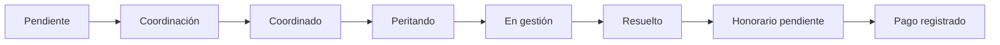

<div align="center">


# InsureTech Assess

**Gestión de siniestros, coordinación de pericias y seguimiento de honorarios.**

Un mismo espacio para compañías, asegurados, productores, talleres y peritos.


[Funcionalidades](#-funcionalidades) · [Instalación](#-instalación) · [Roles](#-roles-y-accesos) · [Mapas](#-ubicaciones-y-hojas-de-ruta) · [Pruebas](#-pruebas)

</div>

---

## ✨ Funcionalidades

| Módulo | Qué permite hacer |
| :--- | :--- |
| **Integración de aseguradoras** | Recibir siniestros por API con credenciales por compañía e idempotencia; probar envíos con un laboratorio administrativo. |
| **Dashboard** | Consultar cantidades por estado, filtrar siniestros y comparar compañías con un gráfico de barras. |
| **Siniestros** | Gestionar estados, adjuntos, datos del asegurado y asignaciones; consultar listados con búsqueda y paginación. |
| **Coordinación** | Registrar modalidad, fecha, horario y domicilio; buscar y confirmar el punto de una pericia presencial. |
| **Hojas de ruta** | Asignar o reasignar peritos y revisar sus inspecciones por día en un mapa con enlaces al siniestro. |
| **Gestión del perito** | Registrar observaciones, adjuntos, unidades de chapa, mecánica y pintura, y repuestos con Select2. |
| **Talleres** | Administrar talleres homologados y no homologados, con domicilio, contacto y horarios; alta desde un modal con control de duplicados. |
| **Configuración** | Definir valores de reparación y honorarios de inspección, para una compañía o para todas las compañías actuales. |
| **Honorarios** | Confirmar cierres, consultar cantidades e importes por perito y compañía y registrar pagos. |
| **Administración** | Gestionar usuarios, roles y noticias. |

### Circuito principal



> Las pericias presenciales requieren una ubicación confirmada al pasar a **Coordinado**. Las inspecciones por fotos o videollamada quedan fuera del mapa.

## 🧰 Tecnologías

- **Backend:** Laravel 12, PHP 8.2 o superior y Eloquent.
- **Interfaz:** Blade, Bootstrap 5, Sass, Vite, jQuery, DataTables y Select2.
- **Datos:** MySQL en desarrollo; SQLite en memoria para pruebas.
- **Permisos:** Spatie Laravel Permission.
- **Mapas:** Leaflet 1.9.4 y OpenStreetMap, con búsquedas puntuales mediante Nominatim.
- **Pruebas:** PHPUnit 11, factories y seeders.

## 🚀 Instalación

### Requisitos

- PHP 8.2 o superior y las extensiones requeridas por Composer y el controlador de base de datos.
- Composer 2.
- Node.js 20.19+ o 22.12+ compatible con Vite 7, y npm.
- Una base de datos MySQL creada para el proyecto.

### Preparar el entorno

Desde la raíz del repositorio:

```bash
composer install
npm ci
cp .env.example .env
php artisan key:generate
php artisan package:discover
```

Editar `.env` con el nombre de la aplicación, su URL y los datos de conexión:

```dotenv
APP_NAME="InsureTech Assess"
APP_ENV=local
APP_URL=http://localhost:8000

DB_CONNECTION=mysql
DB_HOST=127.0.0.1
DB_PORT=3306
DB_DATABASE=insuretech
DB_USERNAME=tu_usuario
DB_PASSWORD=tu_contrasena
```

Crear las tablas:

```bash
php artisan migrate
```

### Datos de demostración

En una **base nueva de desarrollo**, cargar roles, cuentas de prueba y datos de ejemplo:

```bash
php artisan db:seed
```

La carga incluye cinco compañías de seguros y completa los siguientes conjuntos de datos:

| Registros | Cantidad objetivo |
| :--- | ---: |
| Siniestros | 200 |
| Clientes | 200 |
| Talleres | 40 |
| Productores | 8 |
| Inspectores vinculados a usuarios | 10 |

Los siniestros usan números con el prefijo de su compañía, por ejemplo `ML54897894656166` para Mercantil Andina.

> `DatabaseSeeder` inserta roles y permisos con identificadores definidos: no debe repetirse sobre una base ya inicializada. Para completar datos de demostración en un entorno existente, revisar y ejecutar el seeder específico, por ejemplo `php artisan db:seed --class=ClaimSeeder`.

<details>
<summary><strong>Accesos de demostración</strong></summary>

Las cuentas creadas por `SeederUsuariosPorRol` incluyen:

| Rol | Email |
| :--- | :--- |
| CEO | `ceo@example.com` |
| Coordinaciones | `coordinaciones@example.com` |
| Hojas de ruta | `hojas-de-ruta@example.com` |
| Inspectores | `inspectores@example.com` |

Contraseña inicial de estas cuentas: `InsureTech2026!`.

El seeder conserva las contraseñas de las cuentas existentes. También crea cuentas para los demás roles definidos en ese archivo. El rol **Administrativo** se crea sin asignarlo automáticamente a un usuario.

Estas cuentas son exclusivamente para desarrollo y demostración.

</details>

### Iniciar la aplicación

Ejecutar en dos terminales:

```bash
# Terminal 1: aplicación
php artisan serve
```

```bash
# Terminal 2: recursos frontend con recarga
npm run dev
```

Para compilar los recursos:

```bash
npm run build
```

## 👥 Roles y accesos

| Rol | Acceso principal |
| :--- | :--- |
| **CEO** | Administración general, todos los siniestros, configuración de tarifas y honorarios. |
| **Coordinaciones** | Edición y coordinación del siniestro, incluida la búsqueda de su ubicación antes de asignarlo. |
| **Hojas de ruta** | Peritando y Coordinados; asignación de peritos, fechas y horarios, con agenda y mapa. |
| **Inspectores** | Sus propias inspecciones en Peritando o En gestión, su hoja de ruta y sus honorarios. |
| **Administrativo** | Consulta de honorarios, confirmación de cierres y registro de pagos. No configura tarifas. |

Los demás accesos dependen de los roles y permisos asignados. En `APP_ENV=local`, el listado de usuarios permite **iniciar sesión como otro usuario** para probar los distintos perfiles.

## 📍 Ubicaciones y hojas de ruta

La ubicación se registra durante la coordinación:

1. Completar **Dirección** y **Localidad** y seleccionar la modalidad presencial.
2. Usar **Buscar domicilio en el mapa**.
3. Elegir un resultado y revisar el punto; también se puede marcar manualmente sobre el mapa.
4. Presionar **Confirmar punto** y aplicar los cambios del siniestro.
5. Asignar el perito y la fecha desde Hojas de ruta.

El domicilio de la visita y las coordenadas se guardan en `claims`, mediante `inspection_address`, `inspection_latitude` e `inspection_longitude`. El mapa del perito reutiliza esos datos al consultar sus asignaciones del día.

Si cambia el domicilio o la localidad, se debe confirmar nuevamente el punto. Un cambio a modalidad remota elimina las coordenadas de la visita.

### Configuración del mapa

```dotenv
INSPECTION_GEOCODING_URL=https://nominatim.openstreetmap.org/search
INSPECTION_GEOCODING_COUNTRY=ar
INSPECTION_MAP_TILE_URL=https://tile.openstreetmap.org/{z}/{x}/{y}.png
```

Las búsquedas se ejecutan a pedido del usuario, con caché y un límite global de consultas. Los resultados pueden ser aproximados: encontrar una calle no garantiza identificar la altura exacta.

> **Nominatim público:** uso puntual, máximo una consulta por segundo, sin autocompletado ni geocodificación masiva habitual. No enviar nombres ni información personal o confidencial. Consultar su [política de uso](https://operations.osmfoundation.org/policies/nominatim/) y la [política de teselas de OpenStreetMap](https://operations.osmfoundation.org/policies/tiles/). Los mapas y las búsquedas requieren conexión a estos servicios externos.

Los datos de demostración no incluyen coordenadas confirmadas ni generan búsquedas masivas al ejecutar los seeders.

## 💰 Tarifas y honorarios

**Configuración** se divide en dos secciones exclusivas del CEO:

| Sección | Valores |
| :--- | :--- |
| **Chapa, pintura y mecánica** | Día y hora de chapa, día y hora de mecánica, y paño de pintura. |
| **Inspecciones** | Pericia presencial, por fotos y por videollamada. |

En ambas se puede aplicar un conjunto de valores a **una compañía** o a **todas las compañías actuales**. Esta última opción reemplaza sus valores vigentes; no crea un valor por defecto para compañías futuras.

Las cantidades de reparación admiten hasta dos decimales, como `0.5`. El cálculo se realiza en el servidor y los presupuestos conservan sus tarifas acordadas; un cambio de unidad toma la tarifa vigente de esa unidad.

Al confirmar un siniestro **En gestión** como **Resuelto**, CEO o Administrativo genera un honorario pendiente de pago con el valor de esa compañía y modalidad. El importe queda registrado para que posteriores cambios de tarifas no lo alteren. El inspector consulta sus propios cobros; administración dispone de totales y filtros por compañía, perito, fecha de cierre y estado de pago.

**Los valores reales se cargan desde Configuración:** los seeders no establecen tarifas comerciales ni generan pagos.

## 🧩 Integración de aseguradoras y laboratorio

`POST /api/v1/integrations/claims` recibe siniestros usando credenciales independientes por compañía, con permiso `claims:create`. El emisor se identifica desde su token; el payload no puede elegir compañía, asegurado interno ni estado. El alta reutiliza `SaveClaim`, crea el asegurado y comienza en **Pendiente**.

Los reintentos equivalentes conservan el mismo siniestro; mismo ID externo con otros datos devuelve **409**. Un bloqueo de la compañía y la restricción única protegen solicitudes simultáneas, incluso con distintas credenciales.

El **Laboratorio de aseguradoras** permite generar de 1 a 25 payloads ficticios, previsualizar, confirmar el envío por HTTP y consultar resultados e historial. Requiere CEO o administrador equivalente, `CLAIM_SIMULATOR_ENABLED=true` y entorno local/testing. El token se conserva cifrado en el servidor, sin exponerlo al navegador.

```bash
php artisan migrate --no-interaction
php artisan config:clear --no-interaction
# Requiere habilitar previamente el laboratorio en .env.
php artisan integrations:seed-demo --no-interaction
```

La demo agrega **DEMO Seguro Norte** sin modificar compañías, usuarios ni siniestros existentes. Para el laboratorio se ejecuta un segundo proceso HTTP de la misma aplicación, separado del panel; el cliente sólo permite destinos locales de loopback. No se envían correos. El modo autónomo permite configurar perfiles multiaseguradora y ejecuciones con duración o indefinidas, pausa/reanudación, escenarios y límites. Utiliza un Scheduler compartido y workers de la cola `database/simulations`; no requiere procesos por compañía.

[OpenAPI](integration-openapi.yaml) · [Postman](integration.postman_collection.json).

## 🧪 Pruebas

Ejecutar la suite con una base SQLite en memoria, sin utilizar la base de desarrollo:

```bash
DB_CONNECTION=sqlite DB_DATABASE=:memory: php artisan test --compact
```

Ejecutar un archivo específico:

```bash
DB_CONNECTION=sqlite DB_DATABASE=:memory: php artisan test --compact tests/Feature/CoordinationLocationTest.php
```

Las pruebas cubren permisos y aislamiento por inspector, persistencia de siniestros, coordinación y mapas, cálculos de reparación, configuración por compañía y registro de honorarios y pagos. Las llamadas al geocodificador se simulan en las pruebas de integración.

## 🗂️ Organización del proyecto

```text
app/
├── Http/Controllers/    Controladores de los módulos
├── Http/Requests/       Validación y autorización de formularios
├── Models/              Entidades y relaciones Eloquent
└── Services/            Guardado, cálculos, cierre y geocodificación

database/
├── factories/           Generación de datos de prueba
├── migrations/          Esquema y evolución de la base
└── seeders/             Roles y datos de demostración

resources/
├── js/                  Tablas, mapas y formularios interactivos
├── sass/                Tema, paleta global y estilos compartidos
└── views/               Vistas Blade y componentes

routes/web.php           Rutas web agrupadas por dominio
tests/Feature/          Pruebas funcionales
```

Los nombres de las tablas, campos y rutas principales están en inglés. Parte de los archivos conserva nombres históricos en español. La paleta compartida se define en [`resources/sass/_theme.scss`](resources/sass/_theme.scss).
